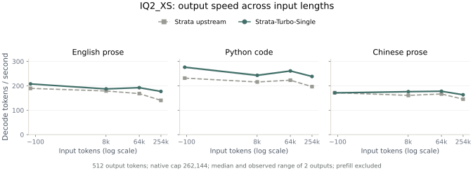
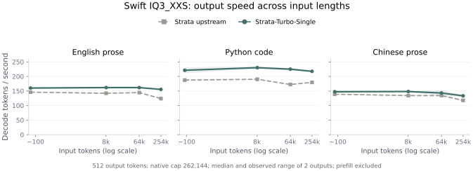
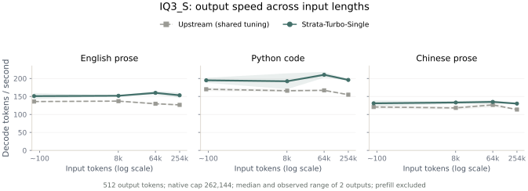
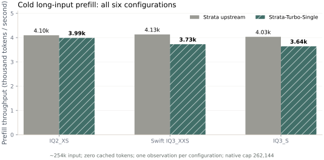
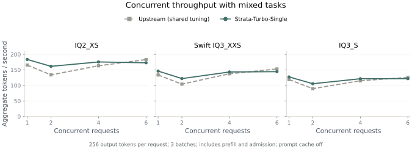

# Strata-Turbo-Single

An unofficial single-NVIDIA-GPU distribution of [Strata](https://github.com/Niko1221/Strata), tuned for local Qwen3.8-Flash-Next inference. OpenAI and Anthropic APIs, native images/video, and up to **six concurrent requests** are included.

The selected target GGUF and its experts are retained. KV precision stays **INT8** and the native context limit stays **262,144 tokens**. This release supports text, images, and video; audio input is unavailable.

## 1. Claude Code pelican showcase

The same **GSQ-RCO IQ2_XS** model completed this exact task through **Claude Code 2.1.290**, using either the pinned upstream engine or Strata-Turbo-Single:

> Create a self-contained HTML file with a 2D SVG animation of a pelican riding a bicycle.

Both engines used one NVIDIA L40S on GPU 2, native context, `--effort max` (mapped to the backend's highest `xhigh` reasoning level), and **65,536 output tokens per model call**. Thinking and final output share that budget; no separate thinking limit was imposed. Each trial started with an empty workspace and a fresh service/session.

| Pinned Strata upstream — first trial | Strata-Turbo-Single — first trial |
|:---:|:---:|
|  |  |
| **128.1 s** · [Original HTML](docs/showcase/pelican/official-1/pelican.html) | **149.6 s** · [Original HTML](docs/showcase/pelican/turbo-1/pelican.html) |

| Engine | Trial 1 | Trial 2 | Median completion time | Model calls, trials 1 / 2 | Reported output tokens, trials 1 / 2 |
|---|---:|---:|---:|---:|---:|
| Strata upstream | 128.1 s | 128.2 s | **128.2 s** | 6 / 6 | 23,650 / 23,678 |
| Strata-Turbo-Single | 149.6 s | 148.1 s | **148.9 s** | 8 / 8 | 30,547 / 30,055 |

In this historical four-trial **ABBA** test, Turbo's median task time was **16.2% higher**. Timing includes CLI startup, thinking, generation, tool calls, and retries through successful completion. Model loading and the identical 64-token warm-up are excluded. The first wire requests match after removing session metadata, but a subsequent audit found that the adapters rendered different billing-header suffixes: **1,226 versus 1,227 prompt tokens**. This run therefore does not isolate the engine difference.

After matching the actual rendered initial prompts, a fresh sequential GPU 0 ABBA rerun measured **240.7 s upstream versus 215.8 s Turbo**, or **10.4% less median completion time**. It uses the incumbent numerical engine with the adapter correction, two trials per engine, and the same highest reasoning setting. The animations above belong to the historical run; the rerun has different generated outputs and tool paths. [Corrected timing evidence](evidence/post-publication/pelican-prompt-fixed.json) · [Rendered-prompt parity](evidence/post-publication/initial-prompt-parity.json).

The [decoder optimization follow-up](experimental/decode-followup-20261010/README.md) records additional kernel and proposal experiments, including losing results. Its completed six-start IQ3_S comparison found only 0.90% short-input / 2.02% long-input improvement over the incumbent, so the candidate is not promoted. The distribution's numerical presets remain v0.2.2.

These are two trials per engine. Output lengths and tool paths differ, so the completion-time ratio is not a pure decoder speedup or a model-quality score. All four original HTML files are preserved without editing. Chromium checks confirm animated SVG content and no requested external dependencies; GIFs show the first six seconds at 20 fps.

View every result in the [four-trial gallery](docs/showcase/pelican/index.html), or open the second-trial originals: [upstream](docs/showcase/pelican/official-2/pelican.html), [Turbo](docs/showcase/pelican/turbo-2/pelican.html). Download HTML files and open them locally; GitHub displays their source. [Timing and API evidence](evidence/showcase/pelican-summary.json) · [Render checks](docs/showcase/pelican/render-checks.json).

## 2. Throughput across tasks, context, and concurrency

The following measurements use the **v0.2.2 release presets**, one **L40S on GPU 0**, and the same selected weights within each engine pair. The comparator is pinned Strata commit [`fb58e0d`](https://github.com/Niko1221/Strata/tree/fb58e0dbc8399662c0e47c76578c6e878b14f6cf), with its original numerical kernels and the common native media reader. It is a reproducible pinned baseline, not a claim about every subsequent upstream release.

The host uses **AMD EPYC 9754 CPUs and approximately 1 TB RAM**; the preset selects **32 CPU workers** on GPU 0's NUMA node. This engine also uses host memory and CPU resources, so the absolute rates are specific to the whole machine, not the GPU alone.

### Decode: task type × input length

Summary values below are arithmetic means of the three task medians, in **decode tokens/s**; the plots retain every task and input-length point.

<!-- BEGIN DECODE SUMMARY TABLE -->

| Weight | Short upstream / Turbo | Short change | ~254k upstream / Turbo | Long change |
|---|---:|---:|---:|---:|
| IQ2_XS | 197.7 / 218.4 | +10.5% | 160.8 / 192.9 | +19.9% |
| Swift IQ3_XXS | 157.5 / 176.3 | +12.0% | 140.5 / 168.8 | +20.2% |
| IQ3_S | 142.2 / 158.9 | +11.8% | 131.7 / 159.8 | +21.3% |

<!-- END DECODE SUMMARY TABLE -->

Each chart contains English prose, Python code, and Chinese prose. The x-axis is the **actual input length**, not the configured context limit; both engines retain the **262,144-token** cap. Each point is the median of two **512-token** outputs, with their observed minimum–maximum range shaded. Thinking is disabled and temperature is zero. Every plotted response is checked to contain all 512 requested tokens; the cores do not implement the request's `ignore_eos` hint. These charts measure the **output stage only**, excluding prefill.







KV prefix caching is enabled. Each input size starts cold; subsequent task/repeat requests can reuse prefixes. Generated answers are not cached. The two outputs share a service lifetime; their range is not a confidence interval. Gains vary by task and context, and some points regress. The highest-reasoning agent test above is deliberately separate from these fixed-length throughput tests.

### Prefill: three weights × two engines

Prefill is measured from the **first cold English request at each input size**, with **zero cached tokens**. The plot shows the approximately 254k-token input; the table includes smaller inputs. This is one observation per configuration and length.



<!-- BEGIN PREFILL TABLE -->

| Weight | Engine | ~8k tokens/s | ~64k tokens/s | ~254k tokens/s | ~254k prefill time |
|---|---|---:|---:|---:|---:|
| IQ2_XS | Strata upstream | 3,617 | 4,406 | 4,096 | 62.0 s |
| IQ2_XS | Strata-Turbo-Single | 3,616 | 4,257 | 3,988 | 63.7 s |
| Swift IQ3_XXS | Strata upstream | 3,660 | 4,458 | 4,131 | 61.5 s |
| Swift IQ3_XXS | Strata-Turbo-Single | 3,347 | 4,061 | 3,726 | 68.2 s |
| IQ3_S | Strata upstream | 3,403 | 4,329 | 4,032 | 63.0 s |
| IQ3_S | Strata-Turbo-Single | 3,130 | 3,940 | 3,642 | 69.7 s |

<!-- END PREFILL TABLE -->

### Concurrent requests: 1, 2, 4, and 6



<!-- BEGIN CONCURRENCY TABLE -->

| Weight | Engine | 1 request | 2 requests | 4 requests | 6 requests | 6-slot median request decode |
|---|---|---:|---:|---:|---:|---:|
| IQ2_XS | Strata upstream | 165.5 | 134.0 | 163.3 | 183.3 | 36.0 |
| IQ2_XS | Strata-Turbo-Single | 183.6 | 161.5 | 175.6 | 172.9 | 35.0 |
| Swift IQ3_XXS | Strata upstream | 133.6 | 104.1 | 137.5 | 153.0 | 29.5 |
| Swift IQ3_XXS | Strata-Turbo-Single | 146.2 | 122.0 | 143.3 | 144.4 | 29.1 |
| IQ3_S | Strata upstream | 118.9 | 89.5 | 115.1 | 125.7 | 24.1 |
| IQ3_S | Strata-Turbo-Single | 127.3 | 105.5 | 121.5 | 121.8 | 23.6 |

<!-- END CONCURRENCY TABLE -->

The slot-count columns report **aggregate end-to-end output tokens/s**: total output divided by total batch wall time, including prefill and admission. The last column reports individual request decode tokens/s at six slots, excluding prefill. Each setting runs three simultaneous batches of mixed English/code/Chinese tasks, **256 output tokens per request**, with thinking and prefix caching disabled. Increasing the slot count does not guarantee increasing throughput.

The concurrent Turbo preset uses upstream native shared batching with **batch MTP** enabled; it shares one model copy. The single-request preset uses the custom Turbo engine. These plots compare the shipped execution presets, rather than attributing every concurrency difference to a custom CUDA kernel. Six near-full-window simultaneous sessions have not been validated.

All measurements, prompts, configuration, binary hashes, and limitations are in the [benchmark methodology](docs/benchmark-methodology.md), [summary](evidence/showcase/benchmark-summary.json), and [raw runs](evidence/showcase/raw). Figures are reproducible with [the plotting script](docs/figures/scripts/plot_showcase.py). These L40S observations do not establish performance on other hardware.

### What changed in the engine

The release combines tuned quantized kernels, execution/cache settings, verified speculative decoding, and model-specific presets. IQ2_XS uses temporary expert-cache loans for prefill chunks up to 16k tokens, then restores the residency table before decode. Swift restores and holds its original cache profile for native media requests, while retaining text adaptation. Target weights, context, and KV precision are unchanged. See [prefill changes](docs/prefill-upgrade.md), [Swift media repair](docs/swift-video-fix.md), and [three-weight tuning](docs/three-weight-tuning.md). No new decoding algorithm or universal SOTA claim is made.

## 3. Install and run

On **Linux x86_64** with an AVX2 CPU and one NVIDIA GPU:

```bash
git clone https://github.com/PullMyBoots/-strata-turbo-single-.git strata-turbo-single
cd strata-turbo-single
./setup.sh
```

Choose a weight when prompted. Setup detects an available GPU, prepares a private Python environment, builds the engines when binaries are absent, downloads the selected weights and auxiliary assets, and runs a local comparison before starting the API. Downloads resume when setup is repeated. A source build requires a CUDA Toolkit; setup uses the pinned upstream Linux build-tool helper where supported.

| Setup weight | Main GGUF size (decimal GB) | Intended tradeoff |
|---|---:|---|
| `iq2_xs` | ~68.0 GB | Smallest supported main weight; speed and resource use |
| `swift` | ~76.0 GB | Swift IQ3_XXS model variant; separate model-matched preset |
| `iq3_s` | ~83.6 GB | Largest supported main weight; higher weight precision |

These are main-weight sizes, not total installation sizes. Auxiliary assets, prepared expert files, and build intermediates require additional disk space; setup checks it before downloading. Main weights are downloaded separately and are not included in this repository.

Subsequent starts reuse the saved settings and a still-valid local verification:

```bash
./start.sh
```

Press Ctrl+C to stop. The default API is **`http://127.0.0.1:8090`**. OpenAI clients use `/v1/chat/completions`; Anthropic clients use `/v1/messages`. Discover the selected model ID with:

```bash
curl http://127.0.0.1:8090/v1/models
```

Useful setup choices:

```bash
# Non-interactive, fastest weight, one GPU; start later.
./setup.sh --yes --weights iq2_xs --gpu 0 --no-start
./start.sh

# Swift with up to six concurrent requests.
./setup.sh --yes --weights swift --gpu 0 --max-concurrency 6

# Reuse a complete prepared asset tree.
./setup.sh --yes --adopt --assets /path/to/assets --weights iq3_s --no-start

# Import downloaded GGUF shards and prepare auxiliary assets.
./setup.sh --yes --gguf-dir /path/to/shards --weights iq2_xs

# Read-only hardware inspection, without loading a model.
./setup.sh --check

# Repeat qualification, including a native-window long prompt.
./setup.sh --verify --verify-long --no-start
```

For remote clients, set `STRATA_API_KEY` in the environment and use `--host 0.0.0.0`. To connect an installed Claude Code to the default IQ2_XS service:

```bash
ANTHROPIC_BASE_URL=http://127.0.0.1:8090 \
ANTHROPIC_API_KEY=local \
claude --model qwen3.8-flash-iq2-xs --effort max
```

Replace `local` with the configured API key when authentication is enabled, and use the ID from `/v1/models` for another weight. The pelican [harness script](tools/benchmark_pelican.py) demonstrates an isolated configuration with identical request settings for both engines.

Resource planning accounts for free VRAM, RAM, CPU affinity, NUMA, and container limits. Smaller GPUs can run the vision encoder on the CPU; low-RAM mode maps experts from disk. The selected GGUF's experts remain available. Context is fixed at the native limit. Insufficient resources cause an explicit error. NVIDIA compute capability **7.5+** is targeted, but performance here is validated only on L40S; native Windows and AMD are not qualified. NVIDIA-enabled WSL2 is an alternative with its own runtime policy.

Turbo is selected after a local ABBA comparison confirms at least **3% aggregate improvement**, no tested output-family regression over **3%**, prefill regression no greater than **10%**, and capability checks. Otherwise setup uses the upstream numerical engine with the native media adapter. Changing hardware, assets, flags, or binaries invalidates that comparison. Qualification covers its specific workloads; the broader charts above can still show regressions.

See [distribution details](docs/distribution.md), [building and assets](docs/build-and-assets.md), and [release verification](docs/distribution-verification.md). To rebuild and create local source/runtime archives:

```bash
./install-python.sh
.venv/bin/python tools/build_distribution.py --arch 89 --nvcc /path/to/nvcc
.venv/bin/python tools/test_distribution.py
.venv/bin/python tools/package_release.py
```

Strata-Turbo-Single is an unofficial fork under the [MIT license](LICENSE). Bundled llama.cpp/ggml retains its license; model and derived auxiliary assets retain their applicable model licenses. [Pinned source provenance](SOURCE_PROVENANCE.json) · [Distribution manifest](distribution/manifest.json) · [Binary manifest](distribution/build.json).
