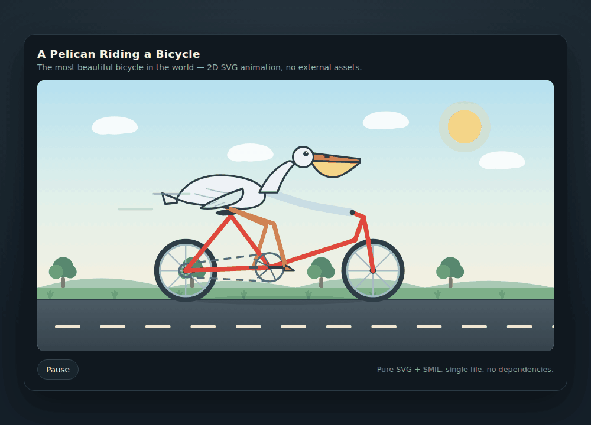

# Strata-Turbo-Single

Single-GPU inference for IQ2_XS, Swift IQ3_XXS, and IQ3_S, with text, image, video, and up to six concurrent requests. Audio input is not supported.

## Performance

**Measured October 11, 2026.** Local hardware: one NVIDIA L40S (48 GB), AMD EPYC 9754, approximately 1 TB RAM, 32 CPU workers. Strata and Strata-Turbo-Single use identical weights and matched resource settings, with a native 262,144-token context and INT8 KV cache. Strata is v0.1.41. These results use optimized experimental builds, not the installer-default engine; [builds and full results](evidence/all-speed-results-20261011/RESULTS.md).

### Pelican animation · Claude Code

> Create a self-contained HTML file with a 2D SVG animation of a pelican riding a bicycle.

Claude Code 2.1.290, `max` effort, identical task and tool permissions, two fresh sessions per model. Times include thinking and tool use; DeepSeek also includes API network time. Local model loading is excluded.

| | DeepSeek V4.1 Flash + Claude Code | IQ2_XS + Strata-Turbo-Single + Claude Code |
|---|---|---|
| First-trial animation |  |  |
| Original HTML | [Trial 1](docs/showcase/deepseek-pelican-20261011/deepseek-1/pelican.html) · [Trial 2](docs/showcase/deepseek-pelican-20261011/deepseek-2/pelican.html) | [Trial 1](docs/showcase/pelican-latest-20261011/turbo-1/pelican.html) · [Trial 2](docs/showcase/pelican-latest-20261011/turbo-2/pelican.html) |

| Model and engine | Trial 1 (s) | Trial 2 (s) | Median (s) |
|---|---:|---:|---:|
| DeepSeek V4.1 Flash API | 333.3 | 181.6 | **257.5** |
| IQ2_XS · Strata-Turbo-Single | 180.2 | 120.2 | **150.2** |

IQ2_XS completed the task in **41.7% less median time** in these trials. All four outputs are self-contained, playable SVG animations. Different models generated different amounts of output; this is task completion time, not a pure engine-speed or quality score. [View all four animations](docs/showcase/pelican-comparison-20261011.html) · [DeepSeek results](evidence/deepseek-pelican-20261011/REPORT.md) · [IQ2_XS results](evidence/pelican-latest-20261011/pelican-summary.json).

### Decode · tokens/s

Higher is faster. Single request, thinking off, median of two 512-token outputs per cell. Columns show background context tokens; task instructions add a small overhead. Prefix caching is enabled.

**English prose**

| Weight | Engine | Short | 8,192 | 65,536 | 253,952 |
|---|---|---:|---:|---:|---:|
| IQ2_XS | Strata | 189.7 | 179.4 | 168.1 | 151.3 |
| IQ2_XS | Strata-Turbo-Single | 210.1 | 202.6 | 199.8 | 178.1 |
| Swift IQ3_XXS | Strata | 145.1 | 145.2 | 148.3 | 129.9 |
| Swift IQ3_XXS | Strata-Turbo-Single | 155.9 | 161.4 | 167.1 | 151.3 |
| IQ3_S | Strata | 135.9 | 133.4 | 134.7 | 126.2 |
| IQ3_S | Strata-Turbo-Single | 147.9 | 151.4 | 142.3 | 154.8 |

**Python code**

| Weight | Engine | Short | 8,192 | 65,536 | 253,952 |
|---|---|---:|---:|---:|---:|
| IQ2_XS | Strata | 231.6 | 215.9 | 223.0 | 194.0 |
| IQ2_XS | Strata-Turbo-Single | 276.2 | 265.5 | 252.1 | 247.8 |
| Swift IQ3_XXS | Strata | 188.6 | 191.8 | 173.4 | 169.4 |
| Swift IQ3_XXS | Strata-Turbo-Single | 228.1 | 223.1 | 226.1 | 220.2 |
| IQ3_S | Strata | 171.0 | 168.0 | 165.8 | 159.0 |
| IQ3_S | Strata-Turbo-Single | 175.3 | 177.1 | 180.4 | 187.8 |

**Chinese prose**

| Weight | Engine | Short | 8,192 | 65,536 | 253,952 |
|---|---|---:|---:|---:|---:|
| IQ2_XS | Strata | 172.1 | 160.8 | 166.6 | 141.8 |
| IQ2_XS | Strata-Turbo-Single | 172.1 | 188.4 | 179.2 | 167.2 |
| Swift IQ3_XXS | Strata | 139.9 | 140.9 | 137.0 | 123.7 |
| Swift IQ3_XXS | Strata-Turbo-Single | 144.7 | 153.6 | 146.8 | 149.2 |
| IQ3_S | Strata | 120.9 | 120.2 | 121.1 | 113.7 |
| IQ3_S | Strata-Turbo-Single | 129.3 | 128.9 | 132.4 | 126.2 |

### Prefill · tokens/s

Higher is faster. Cold prompts, no prefix-cache hits; mean of two fresh single-request starts.

| Weight | Engine | 31,566 input tokens | 256,013 input tokens |
|---|---|---:|---:|
| IQ2_XS | Strata | 4627 | 4231 |
| IQ2_XS | Strata-Turbo-Single | 4962 | 4583 |
| Swift IQ3_XXS | Strata | 4625 | 4256 |
| Swift IQ3_XXS | Strata-Turbo-Single | 4956 | 4373 |
| IQ3_S | Strata | 4535 | 4155 |
| IQ3_S | Strata-Turbo-Single | 4860 | 4270 |

### Concurrent requests · total tokens/s

Higher is faster. Total output across all requests divided by elapsed time, including prefill and scheduling. Each request generates 256 tokens; thinking and prefix caching are off. Mean of two independent service starts, three task waves per start. These are not concurrent full-context requests.

| Weight | Engine | 1 request | 2 requests | 4 requests | 6 requests |
|---|---|---:|---:|---:|---:|
| IQ2_XS | Strata | 165.1 | 134.7 | 164.0 | 183.7 |
| IQ2_XS | Strata-Turbo-Single | 183.0 | 149.1 | 186.9 | 211.8 |
| Swift IQ3_XXS | Strata | 129.6 | 104.1 | 135.2 | 151.1 |
| Swift IQ3_XXS | Strata-Turbo-Single | 142.8 | 113.1 | 150.2 | 172.4 |
| IQ3_S | Strata | 119.5 | 90.1 | 114.4 | 125.3 |
| IQ3_S | Strata-Turbo-Single | 127.8 | 96.0 | 124.2 | 136.8 |

[Download tables and raw measurements](evidence/all-speed-results-20261011/RESULTS.md) · [Decode protocol](evidence/readme-latest-curves-20261011/summary.json) · [Prefill and concurrency protocol](evidence/readme-full-matrix-20261011/REPORT.md)

---

## Install and run

On **Linux x86_64** with an AVX2 CPU and one NVIDIA GPU:

```bash
git clone https://github.com/PullMyBoots/-strata-turbo-single-.git strata-turbo-single
cd strata-turbo-single
./setup.sh
```

Choose a weight when prompted. Setup detects an available GPU, prepares a private Python environment, builds the engines when binaries are absent, downloads the selected weights and auxiliary assets, and runs a local comparison before starting the API. Downloads resume when setup is repeated. A source build requires a CUDA Toolkit; setup uses the pinned Strata Linux build-tool helper where supported.

| Setup weight | Main GGUF size (decimal GB) | Intended tradeoff |
|---|---:|---|
| `iq2_xs` | ~68.0 GB | Smallest supported main weight; speed and resource use |
| `swift` | ~76.0 GB | Swift IQ3_XXS model variant; separate model-matched preset |
| `iq3_s` | ~83.6 GB | Largest supported main weight; higher weight precision |

These are main-weight sizes, not total installation sizes. Auxiliary assets, prepared expert files, and build intermediates require additional disk space; setup checks it before downloading. Main weights are downloaded separately and are not included in this repository.

Subsequent starts reuse the saved settings and a still-valid local verification:

```bash
./start.sh
```

Press Ctrl+C to stop. The default API is **`http://127.0.0.1:8090`**. OpenAI clients use `/v1/chat/completions`; Anthropic clients use `/v1/messages`. Discover the selected model ID with:

```bash
curl http://127.0.0.1:8090/v1/models
```

Useful setup choices:

```bash
# Non-interactive, fastest weight, one GPU; start later.
./setup.sh --yes --weights iq2_xs --gpu 0 --no-start
./start.sh

# Swift with up to six concurrent requests.
./setup.sh --yes --weights swift --gpu 0 --max-concurrency 6

# Reuse a complete prepared asset tree.
./setup.sh --yes --adopt --assets /path/to/assets --weights iq3_s --no-start

# Import downloaded GGUF shards and prepare auxiliary assets.
./setup.sh --yes --gguf-dir /path/to/shards --weights iq2_xs

# Read-only hardware inspection, without loading a model.
./setup.sh --check

# Repeat qualification, including a native-window long prompt.
./setup.sh --verify --verify-long --no-start
```

For remote clients, set `STRATA_API_KEY` in the environment and use `--host 0.0.0.0`. To connect an installed Claude Code to the default IQ2_XS service:

```bash
ANTHROPIC_BASE_URL=http://127.0.0.1:8090 \
ANTHROPIC_API_KEY=local \
claude --model qwen3.8-flash-iq2-xs --effort max
```

Replace `local` with the configured API key when authentication is enabled, and use the ID from `/v1/models` for another weight. The pelican [harness script](tools/benchmark_pelican.py) demonstrates an isolated configuration with identical request settings for both engines.

Resource planning accounts for free VRAM, RAM, CPU affinity, NUMA, and container limits. Smaller GPUs can run the vision encoder on the CPU; low-RAM mode maps experts from disk. The selected GGUF's experts remain available. Context is fixed at the native limit. Insufficient resources cause an explicit error. NVIDIA compute capability **7.5+** is targeted, but performance here is validated only on L40S; native Windows and AMD are not qualified. NVIDIA-enabled WSL2 is an alternative with its own runtime policy.

Turbo is selected after a local ABBA comparison confirms at least **3% aggregate improvement**, no tested output-family regression over **3%**, prefill regression no greater than **10%**, and capability checks. Otherwise setup uses the Strata numerical engine with the native media adapter. Changing hardware, assets, flags, or binaries invalidates that comparison. Qualification covers its specific workloads; performance varies by workload.

See [distribution details](docs/distribution.md), [building and assets](docs/build-and-assets.md), and [release verification](docs/distribution-verification.md). To rebuild and create local source/runtime archives:

```bash
./install-python.sh
.venv/bin/python tools/build_distribution.py --arch 89 --nvcc /path/to/nvcc
.venv/bin/python tools/test_distribution.py
.venv/bin/python tools/package_release.py
```

Strata-Turbo-Single is an unofficial fork under the [MIT license](LICENSE). Bundled llama.cpp/ggml retains its license; model and derived auxiliary assets retain their applicable model licenses. [Pinned source provenance](SOURCE_PROVENANCE.json) · [Distribution manifest](distribution/manifest.json) · [Binary manifest](distribution/build.json).
